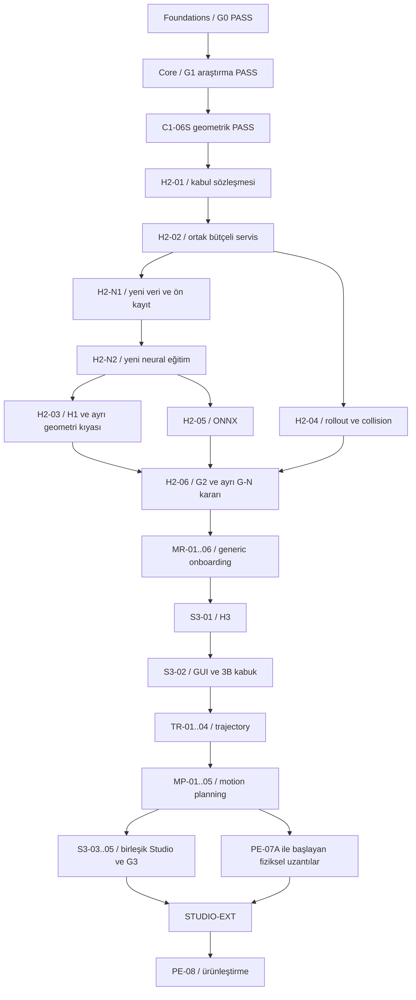

# NeuroKinematics — revize ana roadmap

**Plan r3 · 11 Ekim 2026 · Sıradaki iş: H2-01.**
Foundations/G0 PASS; Core/G1 araştırma PASS; C1-06S KUKA geometrik IK PASS.
Eski doğrudan neural hedef NOT_MET; yeni neural model henüz eğitilmedi.
Hybrid, yeni eğitim ve aşağıdaki uzantıların uygulaması NOT_STARTED.

[C1 denetimi](../../experiments/PLAN-20261011-ROADMAP/C1_READINESS_AUDIT.md)
· [Mimari karar](../adr/ADR-027-roadmap-revision-and-neural-role.md)
· [Dört PDFnin eşlemesi](SOURCE_MAPPING_r3.md)
· [Makine okunur 39 görev](ROADMAP_TASKS_r3.json).

## Amaç ve korunacak sonuçlar

Hedef, robot modelinden doğrulanmış IK, planlama, zaman-parametreli hareket,
simülasyon ve ileride ölçümlü fiziksel yürütmeye uzanan tekrar kullanılabilir bir
platformdur. Neural bileşen ölçülen katkı üretmelidir; doğruluk kabulü bağımsız
kinematik ve etkin geometri/zaman kontrollerine dayanır.

G0/G1 kapanışları ve orijinal rapor/deneyler yeniden yazılmıyor. C1-06S yeni
geometrik başarıdır; başarısız MLPnin başarılı eğitildiği anlamına gelmez.
Özgün bilimsel **H2 hipotezi REJECTED**, sonraki **Hybrid/H2 faz kodu** ile farklıdır.
H1 learned-seed katkısı hâlâ ölçülmedi. Ayrı **G-N** kapısı bu iddiayı izler.

## Geliştirme sırası

Şema kapıların özetidir; kesin görev bağımlılıkları görev dosyaları ve JSONdadır.
Bir görevin sıra numarası tek başına izin değildir: bütün ön koşul kapıları kapanmalıdır.

| Konum | İş paketi | Giriş → çıkış | Durum / tahmini etkin emek |
|---|---|---|---|
| 0 | [Foundations](F0_Foundations.md) | Robot → G0 | Tamamlandı; tarihsel 60–90 saat tahmini, gerçekleşen süre değil |
| 1 | [Core](C1_Core.md) + C1-06S | G0 → G1 + geometrik kabul | Araştırma/geometri tamam; neural hedef açık |
| 2 | [Hybrid + yeni neural](H2_Hybrid.md) | G1/C1-06S → G2; G-N ayrı | 8 görev; 150–232 saat |
| 3 | [MR generic onboarding](MR_MultiRobot.md) | G2 → G-MR | 6 görev; 88–152 saat |
| 4 | [Studio](S3_Studio.md) S3-01/02 | G-MR → H3 + GUI kabuğu | Özgün 5 Studio görevinin ilk ikisi |
| 5 | [TR trajectory](TR_Trajectory.md) | S3-02 → G-TR | 4 görev; 52–82 saat |
| 6 | [MP motion planning](MP_MotionPlanning.md) | G-TR → G-MP | 5 görev; 66–112 saat |
| 7 | Studio S3-03/04/05 | G-MP → G3 | Tüm 5 Studio görevi toplam 80–130 saat |
| 8 | [PE fiziksel uzantılar](PE_PhysicalExecution.md) | G-MP; UI için G3 → G-PE | 11 iş; donanım/spec sonrası tahmin |

H2den G3e kalan yeni plan toplamı **436–708 etkin saat**; %25 planlama payıyla
**545–885 saat**. Bu değer uygulama tahminidir, ölçülmüş çalışma süresi veya bitiş
sözü değildir. Eğitim çalışma/bekleme süresi ve donanım temini ayrıca hesaplanır.
Eski 330–520 saatlik dört faz toplamı bu genişletilmiş kapsamı karşılamaz.
PE için donanım/ölçüm düzeneği/ekip netleşmeden toplam süre uydurulmaz.

## Fiziksel uzantıların kesin sırası

PE-07A kapsam/güvenlik gereksinimleri → PE-01 digital twin → PE-02 ROS/mock
haberleşme → PE-03 embedded/bench → PE-05A temel kalibrasyon → PE-06 HIL →
PE-07B yürütme kilidi kabulü → PE-04 kapalı çevrim gerçek yürütme → PE-05B
ölçülmüş sim-to-real → STUDIO-EXT (ayrıca G3) → PE-08 güvenilirlik/ürünleştirme.

Kaynak PDFde PE-04 sonrası yerleştirilen temel kalibrasyon/HIL/safety ön koşulları
burada öne alındı. PE-05 ve PE-07 kaynak kimlikleri A/B alt işleriyle korunur.
PE-03/05A/06 yalnız tanımlı bench/commissioning kapsamını açar; tam trajectory
yürütmesi PE-07B olmadan açılamaz. Digital twin VALID tek başına fiziksel izin değildir.

## Çalışma zamanı akışı

Robot/gerçek veya simüle state → hedef pose → doğrulanmış IK → hedef joint →
motion planner → geometrik path → trajectory generator → q(t), dq(t), ddq(t) →
nihai geometri/limit/twin denetimi → simülasyon; ileride yetkilendirme → fiziksel
execution → actual feedback → tracking ve bağımsız doğruluk değerlendirmesi.

Geliştirmede TR önce, MP sonra gelir; çalışma zamanında **MP önce, TR sonra**.
IK, trajectory, motion planning ve embedded motor kontrolü ayrı sorumluluklardır.

## Kapılar ve başarısızlık politikası

| Kapı | Ne kanıtlar? | Ne kanıtlamaz? |
|---|---|---|
| G0 | Model/FK/Jacobian/veri ölçüm güvenilirliği | Fiziksel robot doğruluğu |
| G1 | Core araştırma kapanışı | Başarılı direct-neural ürün |
| C1-06S | Sabit KUKA dağılımında geometrik IK | Bütün robotlar, deadline/collision |
| G2 | Kabul/hata/bütçe/rollout/ONNX/temiz servis | Neural avantajın otomatik varlığı |
| G-N | Bağımsız ölçülmüş neural katkı | Salt eğitim bitti, teacher başarılı |
| G-MR | Üç robot/configle doğrulanmış onboarding | Zero-shot/arbitrary DOF genelleme |
| G-TR | Limitli zaman-parametreli simülasyon hareketi | Engelden kaçan global path |
| G-MP | Tanımlı statik sahnede doğrulanmış path | Sürekli veya fiziksel safety garantisi |
| G3 | Destek kapsamıyla kullanılabilir Studio | Fiziksel hardware readiness |
| G-PE | Ölçülmüş sınırlı fiziksel destek profili | Tüm robot/yük/ortamlarda uygunluk |

H2-N1/N2 yeni eğitim görevleri atlanmaz. Olumsuz bilimsel sonuç kayıtla kapanabilir;
G-N açık kalır ve sonraki araştırma seçimi G2 raporunda ön kayıtlanır. Neural fayda
yoksa kullanıcıya başarısız NN zorunlu tutulmaz. Yeni robotta FULLY_READY için
robot bazlı ön kayıtlı kalite kapıları gerekir; yalnız numerical-ready ayrı hizmettir.
Zorunlu test çalışmadıysa NOT_RUN, sayısal şartname eksikse BLOCKED_SPEC, donanım
yoksa WAITING_HARDWARE. Bunlar PASS değildir. Eski eşikler düşürülmez.

## Şimdi başlayacak tek iş

[H2-01 görev dosyası](../tasks/H2-01.md): iki hashli Core devrini yükle,
SolverRequest/Result ve motor kimliği/validation scope sözleşmesini kur, yanlış
model/bozuk girdi/UNRESOLVED/collision NOT_CHECKED/LATE_VALID durumlarını test et.
Kapanış kanıtı olmadan H2-02 uygulanmaz. Bu revizyon yalnız denetim ve plandır;
H2 kodu, yeni eğitim veya robot yürütmesi bu oturumda başlatılmadı.

## Kayıt ve revizyon yönetimi

Her görev: tanımı oku → protokol/kimliği dondur → uygula → test → ham kanıt →
RUN_REPORT → STATUS/TRACEABILITY → hashli devir. Belge r3 yazılım sürümü değildir.
v2/v3 mevcut hedef sürüm adları; MR/TR/MP destek kapsamını genişletir, release
etiketi kabulden sonra belirlenir. PE sürümü şimdiden yayımlanmış sayılmaz.

Eski planların [aynı baytlı arşivi](archive/pre-r3-20261011/docs/roadmaps/MASTER_ROADMAP.md),
[kaynak SHA kaydı](../../experiments/PLAN-20261011-ROADMAP/source-inventory.json)
ve [plan revizyonu çalışma kaydı](../../experiments/PLAN-20261011-ROADMAP/RUN_REPORT.md) korunur.
Özgün r1 teknik raporlar ve C1 frozen teslimi değişmez. README, C1-07 hashli
tesliminin tarihsel parçası olarak korunmuştur; güncel giriş bu roadmap ve
`docs/MASTER_ROADMAP.md`dir.
